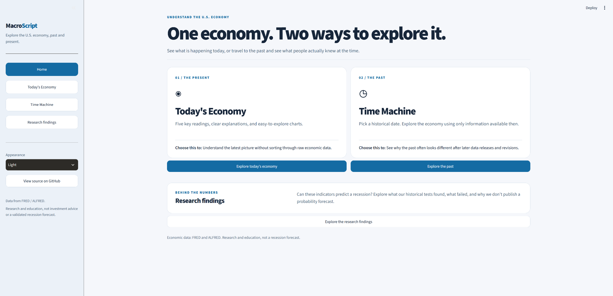
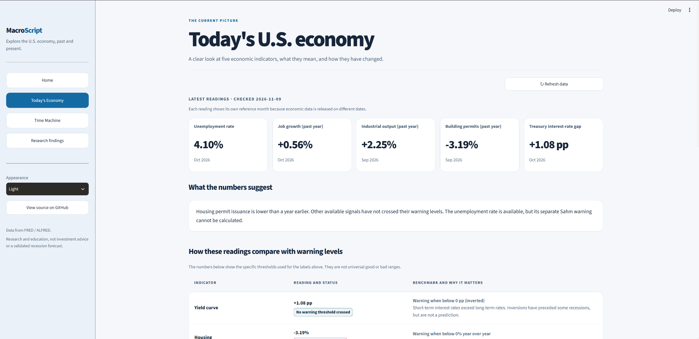
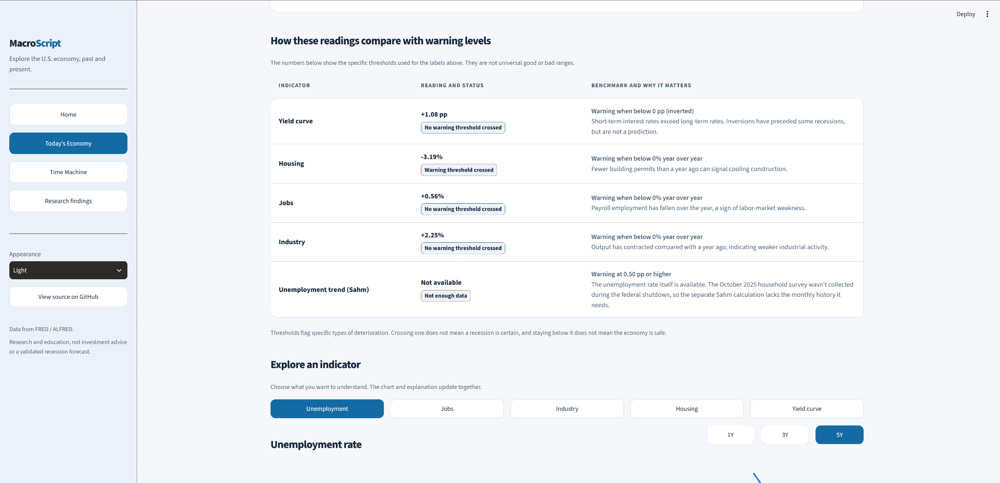
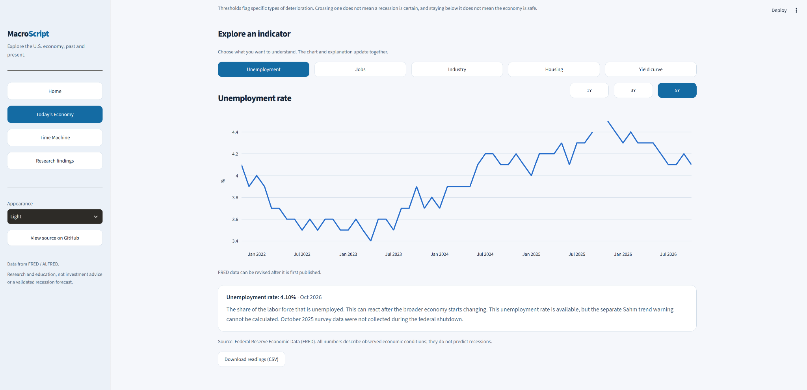
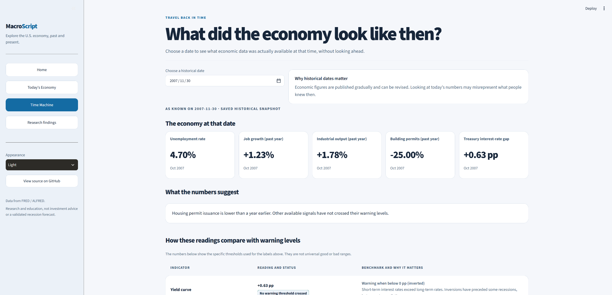
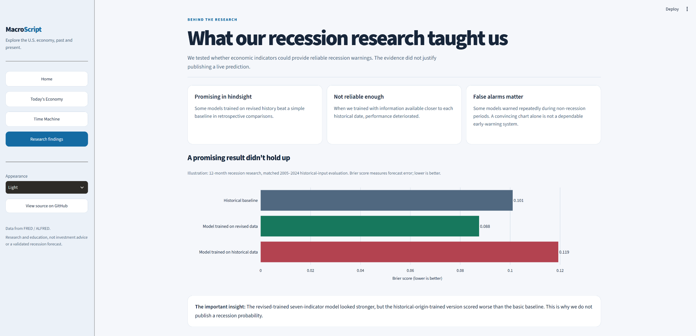

# MacroScript

**Explore the U.S. economy today, or see what was actually known at a date in the past.**

MacroScript is a local-first **Python + Streamlit** research dashboard built around Federal Reserve Economic Data (**FRED**) and its historical archive (**ALFRED**). It makes five economic indicators easier to understand, while distinguishing today's revised figures from information available to analysts at the time.



*Three ways to explore: current conditions, historical information, and the lessons from our recession-model experiments.*

## Explore the dashboard

### 1. Today's Economy

See the latest published readings for unemployment, job growth, industrial output, building permits, and the Treasury interest-rate spread. Each reading includes its reference month, because these series are published on different schedules.



Below the summary, the dashboard explains **what each warning threshold means**, whether the latest data cross it, and why the metric matters. You can also switch between indicators and view their historical trends directly on the same page. These are transparent diagnostic rules, **not recession probabilities or universal good/bad economic grades**.

<details>
<summary><strong>View indicator benchmarks and interactive chart screenshots</strong></summary>

**Warning levels and explanations**



**Indicator trends**



</details>

### 2. Time Machine

Choose a historical date to explore the U.S. economy **using information available by that date**, rather than looking back with today's revised data. The page uses the same cards, benchmark explanations, and indicator charts as Today's Economy.



The screenshot shows a **saved local month-end snapshot from November 30, 2007**. Other dates can be requested from ALFRED with a FRED API key. See [Historical data availability](#historical-data-availability) for what a fresh GitHub clone can reproduce.

### 3. Research Findings

MacroScript began with a question: *Could economic data provide reliable recession warnings?* Models sometimes looked promising when evaluated with revised historical figures, but those gains did not hold up reliably with more historically faithful inputs. Rather than show an unvalidated live probability, the app summarizes what the research found and where it fell short.



The chart uses **Brier score (lower is better)** to illustrate a retrospective comparison; it is **not** evidence of a deployable prediction model. The longer [V6 research report](research/MacroScript_V6_Overview.txt) documents the experiments and their limitations.

*Screenshots were captured November 9, 2026. Displayed readings are dated examples, not permanently current values.*

## Run locally

**Requirements:** Python 3.10+ and a free [FRED API key](https://fred.stlouisfed.org/docs/api/api_key.html).

```powershell
# Download the repository
git clone https://github.com/syedomarali2001/MacroScript.git
cd MacroScript

# Install Python packages
python -m pip install -r requirements.txt

# Configure your personal API key
Copy-Item .env.example .env
# Open .env and replace the placeholder with your FRED_API_KEY.

# Start the dashboard
python -m streamlit run app.py
```

Open the local address displayed by Streamlit (usually `http://localhost:8501`). Use `Ctrl+C` to stop the application. A virtual environment is recommended if you want to keep dependencies separate from your system Python.

The default appearance is **Light**, with **Dark Navy, Ocean Blue, Forest Green, and Burgundy Red** also available.

## The five economic indicators

| Indicator | Displayed measure | What to look for |
| --- | --- | --- |
| Unemployment | Unemployment rate; separate Sahm-style trend warning | A rising unemployment trend can signal weakening conditions. The Sahm-style rule needs enough continuous monthly history. |
| Jobs | Nonfarm payroll growth | Falling payroll employment compared with a year earlier is one potential sign of labor-market weakness. |
| Industry | Industrial production growth | A year-over-year contraction can indicate weaker industrial activity. |
| Housing | Building permits growth | A year-over-year decline may indicate cooling construction activity. |
| Yield curve | Monthly `GS10 − TB3MS` spread | A spread below zero indicates an inverted curve; this is not identical to the daily `T10Y3M` series. |

The benchmark panel shows the rules actually used by the application, including a **0.50 percentage-point Sahm-style threshold**. They do not assign definitive economic grades. The current unemployment rate can be available even when the separate Sahm calculation is unavailable because of a missing month in the source series.

## Historical data availability

MacroScript distinguishes two ways to access past information:

- **Custom ALFRED dates:** With your FRED API key, a fresh clone can retrieve historical vintages on demand where the underlying series are available.
- **Instant saved month-end snapshots:** These use `research/datasets/v5_pit_full_rows.csv` from the original local research archive. The saved revised-data comparison also uses `research/datasets/v5_research_revised.csv`.

**The two dataset CSVs are intentionally excluded from the public repository by `.gitignore`** pending confirmation of redistribution rights. Consequently, the instant archived month-end experience shown in the screenshot is available in the original local project, but **not automatically in a fresh GitHub clone**. The custom ALFRED date path remains the public alternative. The source data are date-based and may not capture intraday publication timing; some vintages and calculated measures may be missing.

The `research/v6_final_audit/` folder contains selected summary results. Recreating all V5/V6 models requires additional research artifacts and code beyond this streamlined dashboard.

## Research outcome

Earlier experiments compared warning rules and recession-risk models using revised and historical-vintage inputs, chronological evaluation, calibration, and robustness checks. Some revised-trained models performed better than simple baselines in retrospect. More historically faithful evaluation was less convincing; model performance and false warnings did **not** justify publishing live recession probabilities.

The evaluation involved few independent recession onsets and was revisited during research. The dashboard is therefore designed for **transparent exploration and education**, not investment advice, reliable recession forecasting, or real-time trading signals.

For detail, see [`research/MacroScript_V6_Overview.txt`](research/MacroScript_V6_Overview.txt) and [`research/MacroScript_V5_Overview.txt`](research/MacroScript_V5_Overview.txt).

## Project layout

```text
MacroScript/
├── app.py                  # Streamlit dashboard and UI
├── config.py               # Indicator catalog
├── fred_client.py          # FRED API calls
├── history.py              # ALFRED vintage handling
├── data_loader.py          # Current and historical data loaders
├── data_quality.py         # Missing-data and freshness checks
├── features.py             # Indicator calculations
├── signals.py              # Rule-based economic interpretation
├── assets/                 # Dashboard screenshots used here
├── research/               # Research overviews and evaluation outputs
│   └── datasets/           # Local-only source CSVs (Git-ignored)
├── tests/                  # Automated tests
├── requirements.txt
├── .env.example             # Safe configuration template
└── .gitignore
```

To run the included tests:

```powershell
python -m unittest discover -s tests -p "test_*.py" -v
```

## Data attribution and security

Economic observations come from [FRED](https://fred.stlouisfed.org/) and historical vintages from [ALFRED](https://alfred.stlouisfed.org/), services of the Federal Reserve Bank of St. Louis. Underlying sources include the U.S. Bureau of Labor Statistics, U.S. Census Bureau, the Federal Reserve, and other originating agencies.

The relevant series are [UNRATE](https://fred.stlouisfed.org/series/UNRATE), [PAYEMS](https://fred.stlouisfed.org/series/PAYEMS), [INDPRO](https://fred.stlouisfed.org/series/INDPRO), [PERMIT](https://fred.stlouisfed.org/series/PERMIT), [GS10](https://fred.stlouisfed.org/series/GS10), and [TB3MS](https://fred.stlouisfed.org/series/TB3MS).

Data use is subject to [FRED API terms](https://fred.stlouisfed.org/docs/api/terms_of_use.html) and the rights of originating providers. MacroScript is an independent project and is not affiliated with or endorsed by the Federal Reserve Bank of St. Louis.

**Never upload `.env`, API keys, `.streamlit/secrets.toml`, private caches, or local research datasets without reviewing their contents and distribution rights.** Keep `.env.example` in Git instead. If a secret has ever been pushed, rotate it; removing it from the latest commit does not erase its prior Git history.
